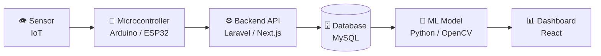

<!-- Taruh file ini sebagai README.md di repo PUBLIK bernama persis: LillahKhrnsaa/LillahKhrnsaa -->

<div align="center">


<a href="https://github.com/LillahKhrnsaa">
  
</a>

<br/>


</div>

---

## 👋 About Me

```text
> whoami
Lillah Khairunissa · Junior Developer

> focus
Backend  →  APIs, databases, server logic
IoT      →  sensors, microcontrollers, real devices
ML       →  computer vision, data → predictions

> mission
Build systems that sense, think, and serve.
```

- 🛠️ Membangun **backend & web app** (PHP/Laravel, Next.js, Prisma, MySQL)
- ⚡ Mengerjakan **IoT**: Arduino, sensor, dan sistem yang terhubung ke server
- 🧠 Belajar & eksplor **Machine Learning**, terutama **computer vision** (OpenCV)
- 🤖 **Mentor di Buana Perjuangan Robotic Club**, mengajar robotik dari nol ke project
- 📍 *(isi lokasi / kampus kamu di sini)*

---

## 🧩 Satu Alur, Tiga Keahlian

Aku suka proyek yang menyambungkan dunia fisik ke software dari ujung ke ujung:



| | ⚙️ **Backend** | ⚡ **IoT** | 🧠 **Machine Learning** |
|---|---|---|---|
| **Fokus** | REST API, auth, database, CRUD | Sensor, aktuator, wiring, firmware | Computer vision, data processing |
| **Stack** | PHP · Laravel · Filament · Node.js · Prisma · MySQL | Arduino · C++ · HC-SR04 · DHT11 | Python · OpenCV |
| **Bukti** | [Laravel-Filament-v3](https://github.com/LillahKhrnsaa/Laravel-Filament-v3) · [ProjectNextJs](https://github.com/LillahKhrnsaa/ProjectNextJs) | [Bprotic-P1](https://github.com/LillahKhrnsaa/Bprotic-P1) | [Color-Detection-Python-OpenCv](https://github.com/LillahKhrnsaa/Color-Detection-Python-OpenCv) |

---

## 🧰 Tech Stack

<div align="center">

<br/>
<br/>


</div>

<details>
<summary>📋 <b>Detail per kategori</b></summary>

| Kategori | Teknologi |
|----------|-----------|
| **Backend** | PHP, Laravel, Filament v3, Node.js, Prisma ORM |
| **Frontend** | Next.js, React, Tailwind CSS |
| **Database** | MySQL |
| **IoT / Embedded** | Arduino (C++), sensor HC-SR04 & DHT11, PWM, Serial |
| **ML / CV** | Python, OpenCV |
| **Tools** | Git, GitHub, Vercel, Postman |

</details>

---

## 🚀 Featured Projects

| Project | Deskripsi | Stack |
|---------|-----------|-------|
| 🌐 [**Bprotic-P1**](https://github.com/LillahKhrnsaa/Bprotic-P1) | Web interaktif pembelajaran robotik (Arduino) · [Live demo](https://bproticp1.vercel.app/) | `HTML` `CSS` `JS` |
| 🧠 [**Color-Detection-Python-OpenCv**](https://github.com/LillahKhrnsaa/Color-Detection-Python-OpenCv) | Deteksi warna secara real-time dengan computer vision | `Python` `OpenCV` |
| 🛠️ [**Laravel-Filament-v3**](https://github.com/LillahKhrnsaa/Laravel-Filament-v3) | Admin panel dengan Laravel + Filament v3 | `PHP` `Laravel` |
| ⚛️ [**ProjectNextJs**](https://github.com/LillahKhrnsaa/ProjectNextJs) | Full-stack: Next.js + Prisma ORM + MySQL | `Next.js` `Prisma` `MySQL` |
| 🏢 [**internship**](https://github.com/LillahKhrnsaa/internship) | Project magang | `PHP` |
| 🎉 [**Insyifest**](https://github.com/LillahKhrnsaa/Insyifest) | Project event | `PHP` |

---

## 🔭 Currently

- 🔨 Mengerjakan: *(project yang sedang kamu bangun, mis. integrasi sensor IoT ke API)*
- 🌱 Belajar: ESP32 + WiFi, REST API untuk data sensor, dan ML dasar
- 🤝 Terbuka untuk kolaborasi di: **IoT + Backend**, **Computer Vision**, proyek robotik

---

## 📊 GitHub Stats

<div align="center">


</div>

---

## 📫 Let's Connect

<div align="center">

<a href="https://github.com/LillahKhrnsaa"></a>
<a href="https://linkedin.com/in/ISI-USERNAME-KAMU"></a>
<a href="mailto:EMAIL-KAMU@gmail.com"></a>
<a href="https://instagram.com/ISI-USERNAME-KAMU"></a>

<i>"Build. Break. Debug."</i> ⚡


</div>
